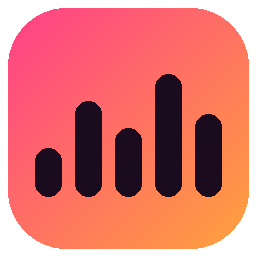
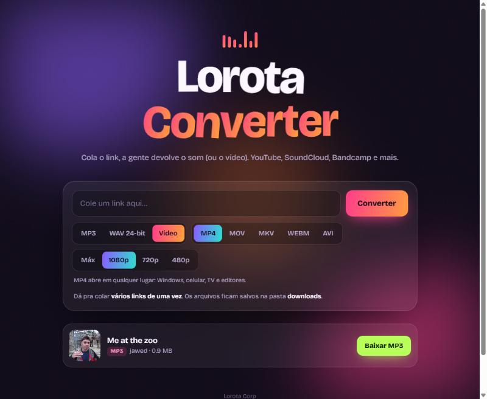

<p align="center">
  
</p>

<h1 align="center">Lorota Converter</h1>

<p align="center">
  App desktop para Windows que transforma links do YouTube, Spotify, SoundCloud, Bandcamp e +1000 sites em <b>MP3</b>, <b>WAV</b> ou <b>vídeo</b>.
</p>

<p align="center">
  <a href="https://github.com/lcsmcm/lorota-converter/releases/latest"><b>⬇️ Baixar para Windows</b></a>
</p>

<p align="center">
  
</p>

## Funcionalidades

- **Áudio MP3**: 128, 192, 256 ou 320 kbps, com capa, título e artista embutidos.
- **Áudio WAV 24-bit**: sem compressão e na taxa de amostragem original da fonte, sem reamostrar.
- **Vídeo** em **MP4, MOV, MKV, WEBM ou AVI**, com resolução **Máx, 1080p, 720p ou 480p**.
  - Dá preferência a H.264 + AAC, que abrem em qualquer player. MP4, MOV e MKV saem sem recodificar, então não perdem qualidade.
- **Links do Spotify**: o áudio do Spotify é protegido, então o app lê o nome, o artista, o álbum e a capa da página pública da música, acha a mesma faixa no YouTube e grava os dados e a capa do Spotify no MP3. Por enquanto funciona com links de música (`/track/`).
- **Vários links de uma vez**: cole uma lista e o app converte tudo em paralelo.
- **Fonte de maior qualidade**: sempre escolhe a faixa de áudio de maior bitrate disponível.
- **Janela nativa**: não abre o navegador. Usa o WebView2 que já vem no Windows 10/11.
- **Executável portátil**: um `.exe` que roda em qualquer PC Windows, sem instalar Python.
- **Interface animada**: logo com letras em onda, fundo em degradê animado e seletores com transição.

## Como funciona

```
┌──────────────────────┐     HTTP local      ┌────────────────────────┐
│ Janela (pywebview)   │ ──────────────────► │ Flask (app.py)         │
│ static/index.html    │ ◄── progresso/JSON ─│  └─ yt-dlp  → download │
└──────────────────────┘                     │  └─ ffmpeg  → conversão│
                                             └────────────────────────┘
```

- **Backend:** Python + [Flask](https://flask.palletsprojects.com/). Cada conversão roda numa thread, e a interface acompanha o progresso consultando a API.
- **Download e extração:** [yt-dlp](https://github.com/yt-dlp/yt-dlp).
- **Conversão:** [FFmpeg](https://ffmpeg.org/).
- **Janela desktop:** [pywebview](https://pywebview.flowrl.com/).
- **Frontend:** HTML, CSS e JavaScript puros, sem framework.
- **Empacotamento:** [PyInstaller](https://pyinstaller.org/), gerando um `.exe` único com ícone gerado por código (`tools/make_icon.py`).

## Rodando a partir do código

Pré-requisitos: **Python 3.11+** e **FFmpeg** no PATH (`winget install Gyan.FFmpeg`).

```bash
git clone https://github.com/lcsmcm/lorota-converter.git
cd lorota-converter
iniciar.bat
```

O `iniciar.bat` cria o ambiente virtual, instala e atualiza as dependências e abre a janela do app.
Para usar no navegador, rode `iniciar.bat --browser`.

## Gerando o executável

```bash
build.bat
```

O resultado é o `Lorota Converter.zip`, com o `.exe`, o `ffmpeg.exe`, o `ffprobe.exe` e um `LEIA-ME.txt`. É só extrair em qualquer PC Windows e abrir.

## Estrutura

```
app.py              servidor Flask + lógica de download/conversão + janela nativa
static/index.html   interface (HTML/CSS/JS)
iniciar.bat         roda o app a partir do código
build.bat           gera o .exe e o .zip portátil
tools/make_icon.py  gera o ícone
tools/package.ps1   monta a pasta final e compacta
```

## Aviso

Projeto pessoal, para fins de estudo. Baixe apenas conteúdo que você tem direito de baixar e respeite os termos de uso de cada plataforma.

---

<p align="center">Lorota Corp</p>
